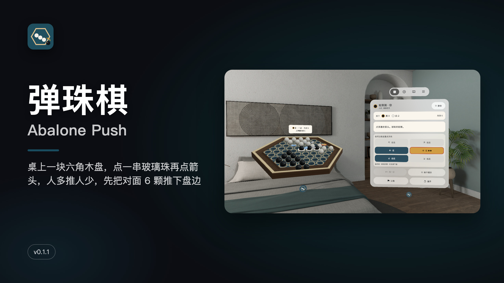
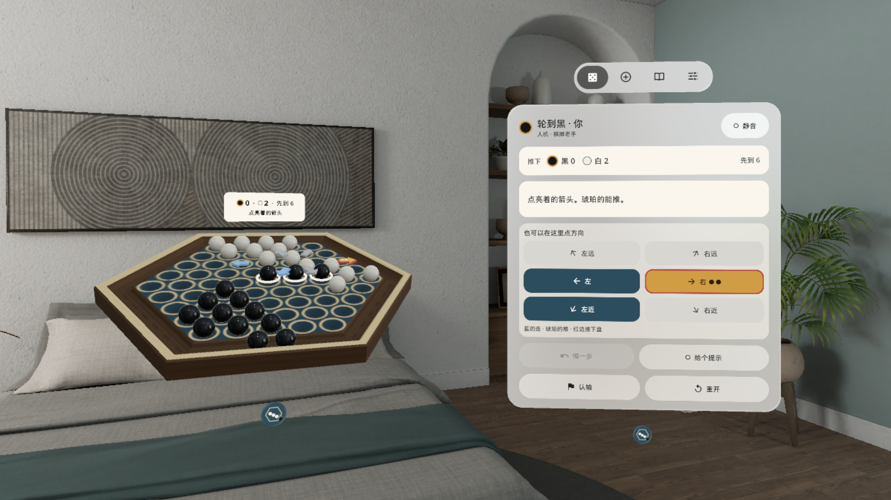
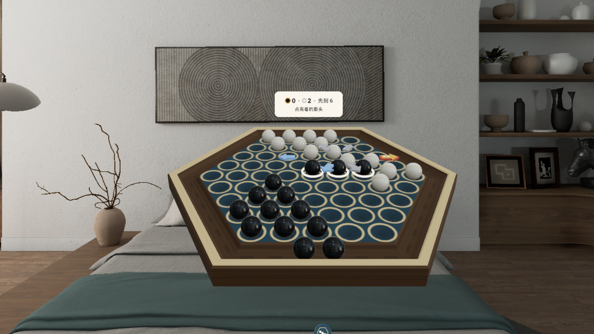
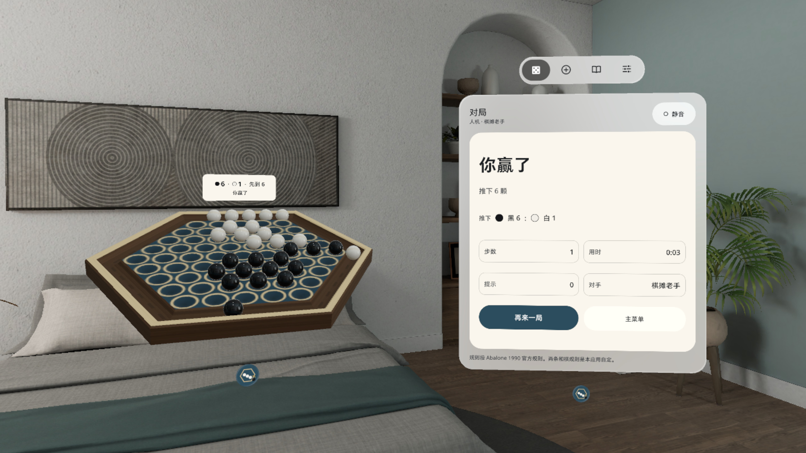
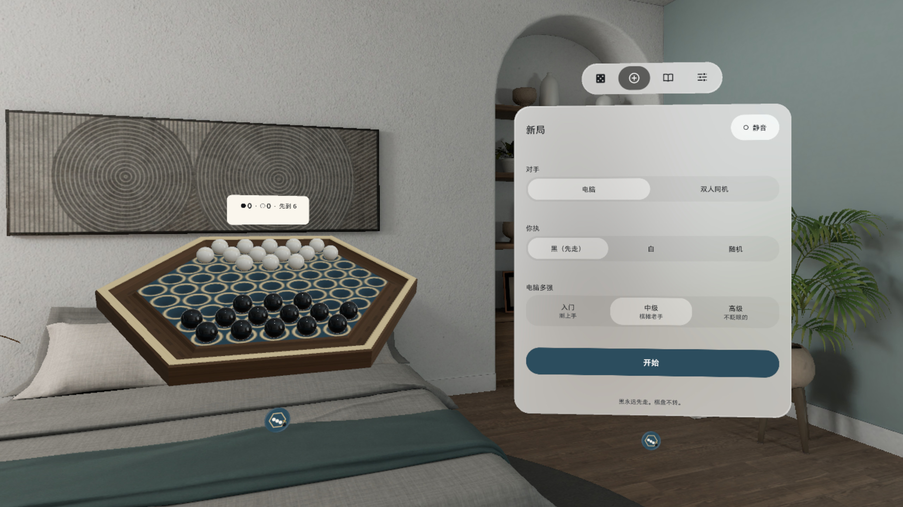
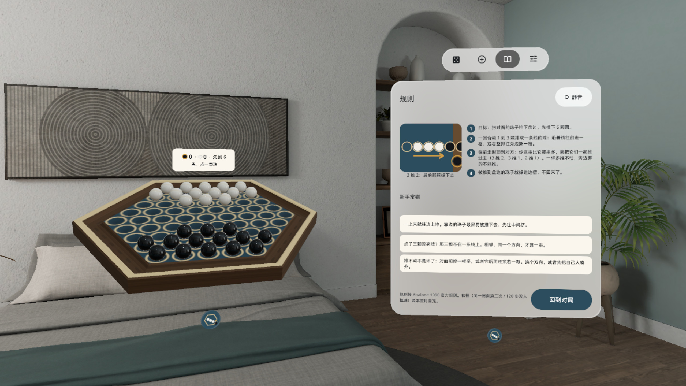

# 弹珠棋 Abalone Push



[中文](#中文) · [English](#english)

---

## 中文

**桌上一块六角木盘，点一串玻璃珠再点箭头，人多推人少，先把对面 6 颗推下盘边。**

PICO 空间应用（PICO OS 6 · Spatial SDK BOM 6.1.9 · Shared Space 体积窗口）。一块 0.6 m 的六角木盘摆在你面前，黑白各 14 颗玻璃珠。规则是经典的 Abalone（1990 官方规则）：每回合动 1 到 3 颗排成一条线的自己的珠，往前走一格或整排侧移一格；往前顶到对方时，你这串比它那串多就能把它们一起推过去；被推下盘边的珠子落进边槽，先推下 6 颗赢。

### 能做什么

- **点串、点箭头**：点自己 1–3 颗成线的珠，选中的珠抬起、套白环；盘上浮出六块 3D 箭头牌——蓝的能走、琥珀的能推（牌上小点 = 推几颗）、红边 = 这一推会把对方送下盘、灰的不行（点了会说为什么）
- **面板上也能走**：控制窗对局页有六个同色的方向键，和箭头牌走同一条路径
- **看得见的推挤**：整串一起滚过去，推挤时「嗒」一声；被推下的珠先抬过唇沿再落进边槽，「叮」一声
- **真实的声音**：滑动、推挤、落槽都是 CC0 实物录音，每次随机变体；选珠声是一声极轻的短音
- **对手**：本机 AI 三档（入门 / 中级 / 高级），或两个人在同一块盘上轮流下；悔一步、给个提示、认输、重开
- **系统原生窗口**：棋盘在系统立体窗口里，用下方系统把手拖动、等比缩放；控制窗（对局 / 新局 / 规则 / 设置）在棋盘右侧
- 每一步自动存档；音量三档、静音、减少动态、首局引导；眼手捏合 / 手柄射线都能点；中英双语；本机运行，不联网、不要账号

### 截图

> v0.1.1 截图来自 PICO 模拟器（画质高清 2560，中文界面），由调试广播驱动，**非真实手势录像**。演示视频 `video-01.mp4` 在 Release 资产里（同样非真实手势录像，无声）。

| | |
|---|---|
|  选好一串：三颗黑珠抬起，盘上亮出蓝箭头和琥珀推牌，控制窗有同色方向键 |  落槽：一颗白珠被推过唇沿，正落进亮起的边槽 |
|  近看木盘：选中的串、箭头牌和远沿上方的计数牌 |  终局：第 6 颗落槽，你赢了 6 : 1 |
|  新局：对手、执子、电脑三档难度 |  规则：一张图 + 四句话 + 新手常错三条 |

### 安装

[Release v0.1.1](https://github.com/kejing-dev/AbalonePush/releases/tag/v0.1.1) 里的 `AbalonePush-v0.1.1.apk` 是 `assembleRelease` 出的未签名包（给应用商店上架用，`adb install` 会拒绝）。自己装请从源码构建 debug 包，头显开启开发者模式并用 USB 连上电脑：

```bash
./gradlew assembleDebug
adb install -r app/build/outputs/apk/debug/app-debug.apk
pico-cli app launch io.embodit.abalonepush
```

需要 PICO OS 6（Android 15，minSdk 35）。不需要额外权限。

### 已知问题

1. v0.1.1 只改了选珠声和命中解析；界面和规则的模拟器 QA 以 v0.1.0 的第 1 轮为准（已过），v0.1.1 由用户在头显上试玩后放行。
2. 调试命令直达终局时，边槽里的珠和比分不一致（真实对局一致）。
3. 珠子落进边槽之前，计数牌上的比分就先加了 1。
4. 坐着看最远一行的箭头牌，张角只有约 2.13°（低于 3° 的规矩），注视点选可能不好点；可以改用面板上的方向键。
5. 手柄射线、手势射线、眼手三种输入在真机上没有逐项验证。
6. 推挤的「嗒」声偏亮。
7. 拖动成串、残局题、棋谱导入导出、更多 AI 档位在下个版本。

### 版本历史

- **v0.1.1**：真机试玩反馈后，选珠 / 加选 / 取消改成同一个极柔短音（低通、0.1 秒、比推挤和落槽低 21 dB 以上），同一种声音同时只放一个；补点中判定回放单测；控制窗页签名称按应用语言显示
- **v0.1.0**：首个版本，六角木盘体积 + 控制窗、Abalone 规则、AI 三档、推挤 / 落槽动画、CC0 音效、中英双语

### 许可与素材

- 字体：Noto Sans（Apache-2.0，见 `third_party/`）
- 音效：Kenney（kenney.nl）impact-sounds / casino-audio，CC0 1.0；「不能走」提示音为合成
- 木盘和玻璃珠模型由 `tools/build_models.py` 纯 Python 生成
- 规则按 Abalone 1990 官方规则；和棋（同一局面第三次 / 120 步没人掉珠）是本应用自定
- 本仓库公开；用 Claude Code 在「黑灯工厂」产线上研发（Claude Opus 5.5 研发 / QA / 发布，Claude Fable 5.1 调研 / 设计）
- 开发结构、调试命令见 [AGENTS.md](AGENTS.md)

---

## English

**A hex wooden board on your table: tap a line of glass marbles, tap an arrow, outnumber the other side and push six of theirs off the rim.**

A PICO spatial app (PICO OS 6 · Spatial SDK BOM 6.1.9 · Shared Space volume). A 0.6 m hexagonal board sits in front of you with 14 black and 14 white glass marbles. The rules are classic Abalone (official 1990 rules): each turn move 1 to 3 of your marbles that sit in a line, one step forward or the whole row one step sideways; push forward into the other side and, if your line is longer than theirs, the whole group rolls; marbles pushed over the rim drop into the gutter. First to push off six wins.

### Features

- **Tap a line, tap an arrow**: tap 1–3 of your marbles in a line and they lift with a white ring; six 3D arrow pads float over the board — blue moves, amber pushes (dots = how many), a red rim means this push sends one off, grey means no (tap it to hear why)
- **Or use the panel**: the Play page has six direction keys in the same colours, going through the same path as the pads
- **Pushes you can see**: the whole line rolls with a "clack" on contact; a marble pushed off lifts over the lip and drops into the gutter with a "ding"
- **Real sounds**: slides, clacks and drops are CC0 recordings with random variants; selecting is a very soft short tick
- **Opponents**: three local AI levels (Beginner / Club / Strong) or two players taking turns on one board; undo, hint, resign, restart
- **Native system window**: the board lives in a system volume — move and resize it with the system handle; the control window (Play / New game / Rules / Settings) sits to its right
- Autosave every move; three volume levels, mute, reduced motion, first-game coach; eye-hand pinch and controller ray both work; Chinese and English; fully offline, no account

### Screenshots

> v0.1.1 PICO emulator screenshots (high-definition 2560, Chinese UI), driven by debug broadcasts — **not a recording of real hand input**. The demo video `video-01.mp4` is a Release asset (also not real hand input, no sound).

| | |
|---|---|
|  A line selected: three black marbles lifted, blue and amber pads on the board, same-colour keys on the panel |  Drop: a white marble pushed over the lip into the lit gutter |
|  Close-up: the selected line, arrow pads and the score tile over the far rim |  Game over: the sixth marble drops, you win 6 : 1 |
|  New game: opponent, colour, three AI levels |  Rules: one diagram, four sentences, three common slips |

### Install

`AbalonePush-v0.1.1.apk` in [Release v0.1.1](https://github.com/kejing-dev/AbalonePush/releases/tag/v0.1.1) is an unsigned `assembleRelease` build (for store submission; `adb install` rejects it). To install it yourself, build the debug APK from source, enable developer mode on the headset and connect it over USB:

```bash
./gradlew assembleDebug
adb install -r app/build/outputs/apk/debug/app-debug.apk
pico-cli app launch io.embodit.abalonepush
```

Requires PICO OS 6 (Android 15, minSdk 35). No extra permissions.

### Known issues

1. v0.1.1 only changes the select sound and hit resolution; emulator QA of the UI and rules is round 1 on v0.1.0 (passed); v0.1.1 was approved after the user played it on a headset.
2. Jumping straight to game over with the debug command leaves the gutter and the score out of step (real games match).
3. The score tile adds 1 before the marble has landed in the gutter.
4. Seated, the farthest row of arrow pads subtends only about 2.13° (below the 3° rule), so gaze selection may be fiddly there; the panel keys work as a fallback.
5. Controller ray, hand ray and eye-hand input were not checked one by one on a headset.
6. The push "clack" is a bit bright.
7. Drag-to-push, endgame puzzles, game record import / export and more AI levels come in the next version.

### Version history

- **v0.1.1**: after headset feedback, select / add / deselect share one very soft short tick (low-passed, 0.1 s, 21 dB+ below pushes and drops) and each sound plays one instance at a time; hit-replay unit test; tab names follow the app language
- **v0.1.0**: first build — hex board volume + control window, Abalone rules, three AI levels, push / drop animation, CC0 sounds, Chinese and English

### Licences and assets

- Font: Noto Sans (Apache-2.0, see `third_party/`)
- Sounds: Kenney (kenney.nl) impact-sounds / casino-audio, CC0 1.0; the "can't move" cue is synthesised
- Board and marble models are generated in pure Python by `tools/build_models.py`
- Rules follow the official 1990 Abalone rules; the two draw rules (third repetition / 120 moves with no marble off) are this app's own
- This repository is public; built with Claude Code on the "lights-out factory" pipeline (Claude Opus 5.5 build / QA / release, Claude Fable 5.1 research / design)
- Project structure and debug commands: [AGENTS.md](AGENTS.md)
